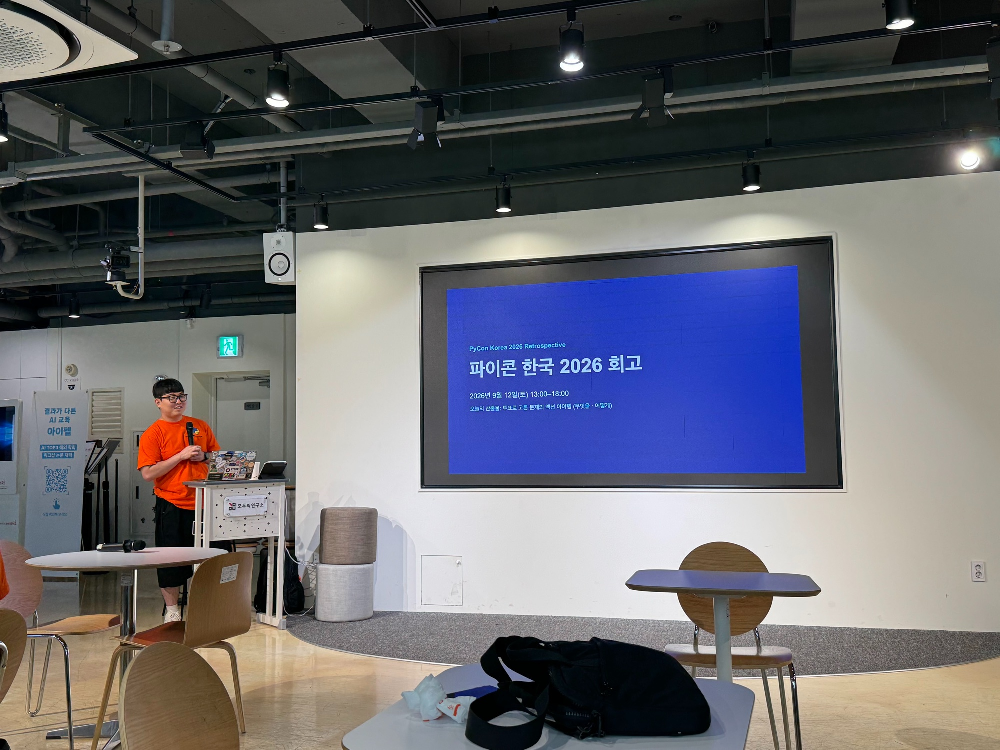
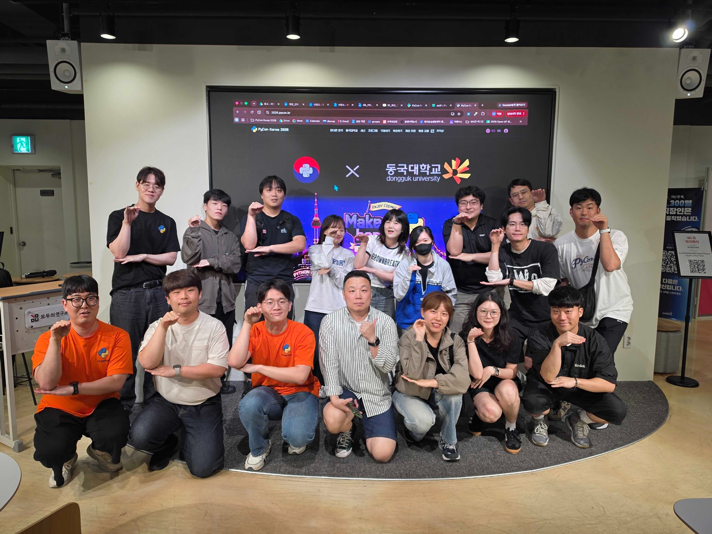
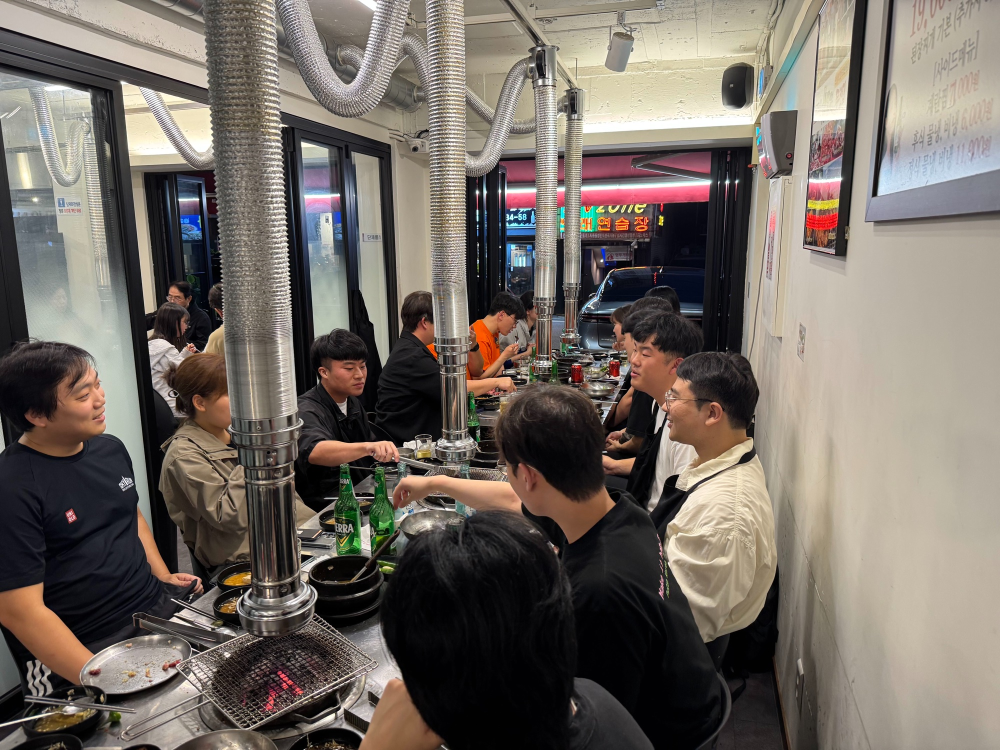
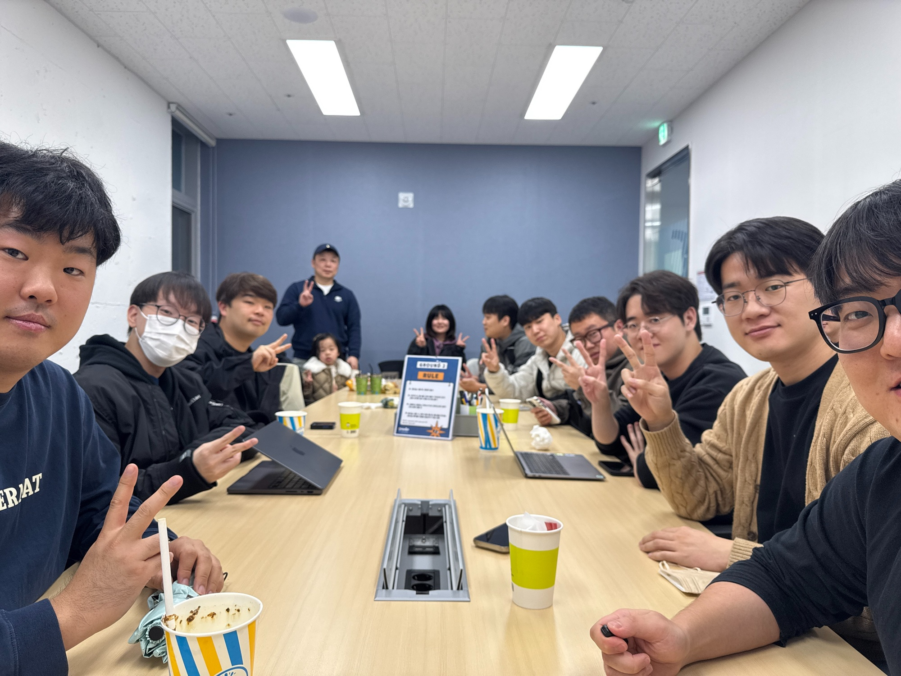

파이콘 한국 2026이 끝난 뒤, 준비위원회는 더 나은 파이콘 한국과 더 나은 준비위원회를 만들기 위해 두 차례의 회고 시간을 가졌습니다. 행사를 준비하던 때부터 행사 중, 그리고 행사가 끝난 뒤까지의 과정을 함께 돌아보았습니다.

## 첫 번째 회고: 부족했던 점을 돌아보고, 개선할 방향을 찾다

첫 번째 회고는 2026년 9월 12일 모두연 라운지에서 열렸습니다.

{:.img-center}

*▲ 파이콘 한국 2026을 함께 돌아보는 첫 번째 회고의 시작*{:.img-caption}

이번 회고는 **행사 준비, 행사 중, 행사 후**로 나누어 진행했습니다. 잘했던 점을 칭찬하는 데 머무르기보다는, 준비위원회가 부족했던 점을 돌아보고 다음에는 어떻게 개선할 수 있을지 함께 생각하는 데 집중했습니다.

많은 이야기가 오가다 보니 한 번의 만남으로 회고를 모두 마무리하지는 못했습니다. 남은 이야기는 두 번째 회고에서 이어 가기로 하고, 함께 저녁을 먹으며 첫 번째 만남을 마쳤습니다.

{:.img-center}

*▲ 첫 번째 회고에 함께한 준비위원들*{:.img-caption}

{:.img-center}

*▲ 회고를 마친 뒤 함께한 저녁 식사*{:.img-caption}

## 두 번째 회고: 남은 이야기를 마무리하고, 새로운 시작을 준비하다

두 번째 회고는 2026년 11월 8일 오픈업에서 열렸습니다. 첫 번째 만남에서 다 나누지 못했던 이야기를 이어 가며, 파이콘 한국 2026의 회고를 마무리했습니다.

{:.img-center}

*▲ 두 번째 회고에 함께한 준비위원들*{:.img-caption}

이날은 **새로운 준비위원회 조직 구성안도 가결**되었습니다. 이에 따라 파이콘 한국 준비위원회는 새로운 조직 구성으로 2027년을 맞이할 계획입니다.

조직 구성의 변화가 당장 모든 문제를 해결해 주지는 않겠지만, 더 나은 방식으로 파이콘을 준비하기 위한 새로운 시작이 될 것 같습니다.

## 2027년에도 Make it hap.py!

파이콘 한국 2026은 끝났지만, 더 나은 파이콘을 만들기 위한 준비위원회의 고민은 계속됩니다.

2027년에도 **Make it hap.py!** 한 파이콘을 만들기 위해 노력하는 파이콘 한국 준비위원회를 기억해 주세요. 앞으로의 여정에도 많은 관심과 응원 부탁드립니다.
